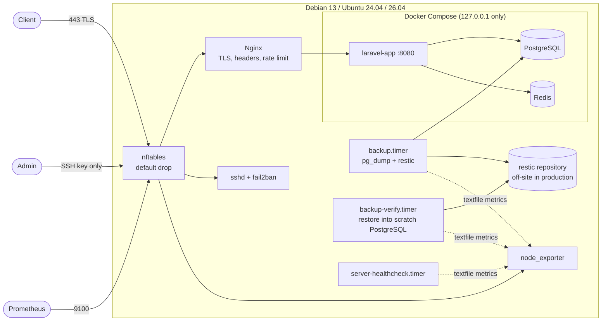

# ansible-server-baseline

[](https://github.com/erfan-zamanzade/ansible-server-baseline/actions/workflows/ci.yml)

Ansible roles that take a fresh Debian or Ubuntu server to a hardened Docker host running a real service behind Nginx, with backups that are restored and checked every week, and a health check that reports into Prometheus.

The service is the image built by [laravel-cicd-pipeline](https://github.com/erfan-zamanzade/laravel-cicd-pipeline) (the same one [k3s-platform-lab](https://github.com/erfan-zamanzade/k3s-platform-lab) runs on Kubernetes). Here it runs on a single server with Docker Compose, which is how many small production services actually live.

Every role is tested with Molecule in systemd containers on Debian 13, Ubuntu 24.04 and Ubuntu 26.04. The tests connect from outside the way a client or an attacker would: they log in over SSH, scan ports, trigger a fail2ban ban, call the app over verified TLS, delete the database and restore it from backup. **Nothing in this repository connects to a real server.**

## What it demonstrates

| Area | How |
|------|-----|
| Hardening | Admin users with exclusive SSH keys, key-only SSH with modern algorithms (post-quantum key exchange where OpenSSH supports it), sysctl hardening, journald limits, unattended security upgrades |
| Safe SSH changes | The role refuses to turn off password logins if nobody in the allowed groups has a key; it handles Ubuntu's socket-activated sshd when the port changes; the playbook opens the new port in the firewall before sshd moves |
| Firewall | nftables with a default-drop input policy in its own table, so reloading it never wipes Docker's or fail2ban's rules |
| Intrusion response | fail2ban on the systemd journal, banning into nftables with drop, longer bans for repeat offenders |
| Docker host | Docker CE from the official repository; the signing key is checked against Docker's published fingerprint; `daemon.json` defaults ports to 127.0.0.1, enables live restore and log rotation |
| Reverse proxy | Nginx with TLS 1.2/1.3, HSTS and security headers, per-IP rate limiting, JSON access logs, `/metrics` closed to the internet, unknown host names refused at the TLS handshake |
| Monitoring | node_exporter from a checksum-verified release in a systemd sandbox; backup, restore and health-check results exported as metrics; alert rules with promtool unit tests |
| Backups | restic with PostgreSQL dumps and retention. A weekly job restores the latest snapshot, loads each dump into a throwaway PostgreSQL container and runs a check query. A restore command for the real database runs in a single transaction |
| Health check | `server-healthcheck`: disks, memory, services, failed units, containers, HTTPS endpoints, certificate expiry and backup age in one report, plus metrics every 5 minutes |
| Testing | Two Molecule scenarios × three distributions, idempotence checked, verification from outside the instance |
| Supply chain | Python tools installed from a hash-locked `requirements.txt`, collections pinned, every download checksum-verified, GitHub Actions pinned to commit SHAs |

## Architecture



## Roles

| Role | What it does |
|------|--------------|
| `baseline` | Packages, timezone, chrony, admin users and sudo, sysctl hardening, journald limits, unattended-upgrades |
| `firewall` | nftables input firewall: SSH (optionally from given networks only), HTTP/HTTPS, monitoring ports only from the monitoring network |
| `ssh_hardening` | Key-only sshd drop-in, `AllowGroups`, modern ciphers/MACs/key exchange, lockout guard, socket-activation aware restarts |
| `fail2ban` | sshd jail on the journal, nftables drop action, incremental ban times |
| `docker` | Docker CE, Compose and Buildx plugins, verified repository key, hardened `daemon.json` |
| `node_exporter` | Pinned, checksum-verified binary, dedicated user, sandboxed systemd unit, textfile and systemd collectors |
| `app` | The demo service with PostgreSQL and Redis in Docker Compose, published on 127.0.0.1 only |
| `nginx` | TLS reverse proxy per site, default server that refuses unknown names, internal-only paths |
| `backup` | restic repository, `backup-run`, `backup-verify` and `backup-restore-db` scripts, systemd timers, metrics |
| `healthcheck` | `server-healthcheck` script and timer, metrics |

Every role validates its inputs with `meta/argument_specs.yml`, and every config file it writes is checked before use (`sshd -t`, `nft --check`, `nginx -t`, `visudo -c`, `dockerd --validate`).

`playbooks/site.yml` applies them in a safe order. `inventories/example/` shows a real-looking inventory with documentation IP addresses and an Ansible Vault example for the secrets.

## Repository layout

```
roles/                     the ten roles
playbooks/site.yml         full server build
inventories/example/       example inventory and group_vars (RFC 5737 addresses)
molecule/hardening/        baseline, firewall, SSH, fail2ban + tests from outside
molecule/site/             the full site.yml + app, TLS, backup/restore and health drills
molecule/resources/        test image (systemd), port probe
monitoring/                Prometheus alert rules and promtool tests
scripts/                   install-tools, lint, molecule wrapper (all pinned in versions.sh)
.github/workflows/ci.yml   lint, then 2 scenarios × 3 distributions
```

## Run the tests

Requirements: Docker, Python 3.12, `make`. Everything else is installed inside the repository.

```bash
make tools                                # uv, virtualenv from requirements.txt (hash-checked), collections
make lint                                 # yamllint, ansible-lint, shellcheck, promtool, actionlint
make test-hardening DISTRO=debian13       # ~4 min
make test-site DISTRO=ubuntu2404          # ~8 min
make test                                 # both scenarios on all three distributions
```

To look around inside a converged instance:

```bash
make converge SCENARIO=site DISTRO=ubuntu2604
make login    SCENARIO=site DISTRO=ubuntu2604
make destroy  SCENARIO=site DISTRO=ubuntu2604
```

## Use it on a server

```bash
cp inventories/example/group_vars/all/vault.yml.example inventories/example/group_vars/all/vault.yml
# fill in passwords and the TLS certificate, then
ansible-vault encrypt inventories/example/group_vars/all/vault.yml
ansible-playbook playbooks/site.yml --ask-vault-pass --check --diff   # dry run first
```

Before the first run, set a key for your own user in `baseline_admin_users` and keep a second session open: the play disables password logins.

## What the tests check

**hardening** (baseline, firewall, ssh_hardening, fail2ban; SSH moved to port 2222):

- network sysctls are live; host-wide kernel sysctls are written for the next boot
- unattended upgrades on, automatic reboot off (`apt-config dump`)
- `sshd -T`: port 2222, no root, no passwords, publickey only
- from outside: the admin logs in with the key and gets root through sudo; a password login is offered only `publickey`; root is refused
- port scan from outside: 2222 open, 22 dropped, 80/443 reachable, 9100 dropped (monitoring allowed only from 192.0.2.10), 5432 dropped
- six failed logins get the Molecule host banned; the port then goes silent; restarting nftables keeps the ban (fail2ban's table survives); unbanning restores access
- running `ssh_hardening` for a group where nobody has a key stops with the lockout error

**site** (the whole `site.yml`):

- `/health` and `/` over HTTPS verified against a test CA, version 1.0.1
- HSTS, `nosniff`, `X-Frame-Options`, no Nginx version; HTTP redirects to HTTPS; an unknown host name gets no TLS handshake
- `/metrics` is 403 from outside and served from the server itself
- the app and dockerd metrics listen on 127.0.0.1 only; port scan matches the firewall rules
- Docker live restore and the `local` log driver are active
- node_exporter is reachable from the monitoring address and exports systemd unit states; `systemd-analyze security` scores its sandbox
- **restore drill**: write a marker row, run the backup and the restore verification, delete the PostgreSQL volume, recreate the stack (empty database), run `backup-restore-db`, and check the marker is back and the app is ready again
- **health drill**: stop Nginx, the health check fails on the service and the HTTPS check and exports `0`; start Nginx, it passes again

Both scenarios run converge twice and fail if the second run changes anything.

## What the tests found

Problems the Molecule runs caught while the roles were written, and what changed:

| Found by | Problem | Fix |
|----------|---------|-----|
| site verify (scraping node_exporter from outside) | With an extra `SystemCallFilter=~@privileged @resources` in the sandbox, node_exporter was killed by seccomp (SIGSYS) on its first real scrape. It had started and listened fine, so a "service is active" check would have passed | Kept the standard `@system-service` filter and added `SystemCallErrorNumber=EPERM`, so a blocked call fails instead of killing the exporter; the test scrapes over the network |
| site converge on Ubuntu 24.04 | Ubuntu 24.04 ships Nginx 1.24, which has no `http2 on;` directive (1.25.1+) | The role reads `nginx -v` and writes `listen … http2` on older versions |
| site converge on all three distributions | Each release's packaged `nginx.conf` sets a different subset of the settings the role wanted to add (`ssl_protocols` on Ubuntu 24.04, still with TLS 1.0 and 1.1; `server_tokens` on Debian 13 and Ubuntu 26.04), and Nginx refuses duplicates | The role writes `nginx.conf` itself; the test checks the effective config (`nginx -T`) has only TLS 1.2 and 1.3 |
| site idempotence | A one-shot `migrate` service in Compose ran again on every `compose up`, so every Ansible run reported a change | Migrations run when the app container starts, which happens once per deploy |
| hardening verify | fail2ban's default action rejects, so a banned scanner still learns the port exists | `blocktype = drop`; the test checks the banned port is silent, not refused |
| hardening converge on Debian 13 | The minimal image has no `sysctl` binary | `procps` is a baseline package |
| site verify (health check) | The test instance's disk is the Molecule host's disk; locally the check correctly reported it at 91% used | The check ignores bind-mounted files and the test raises its threshold; the role default stays at 85% |

## Design notes

- **No `flush ruleset`.** The usual `/etc/nftables.conf` starts with `flush ruleset`, and the packaged unit runs it on stop. On a Docker host that removes Docker's NAT rules and every fail2ban ban. Here the firewall lives in `table inet baseline`, the file replaces only that table, and a drop-in changes the unit's stop command to match. The hardening test restarts nftables during an active ban to prove it.
- **Docker and the firewall.** Ports Docker publishes are NAT-ed before the input chain sees them, so `-p 8080:8080` would bypass any host firewall. The docker role sets `"ip": "127.0.0.1"` in `daemon.json` so a forgotten address binds to localhost, the app is published on 127.0.0.1, and the test checks both the listeners and the port scan.
- **Backups are only as good as the last restore.** `backup-verify` reads back part of the repository data, restores the latest snapshot with hash verification and loads each dump into a disposable PostgreSQL container started from the production image with no network. The check query has a minimum (for the demo: at least three migrations).
- **Metrics instead of e-mail.** Backup, restore and health-check results are files for node_exporter's textfile collector, so they show up in the same Prometheus as everything else. `monitoring/alerts.yml` alerts on failures, on staleness, and on hosts that never report.
- **Containers are not servers.** The test containers are privileged and share the host's kernel and clock. The baseline role therefore writes kernel-wide sysctls without applying them inside a container, and the tests turn chrony off. On a real server both are applied.

## CI

`.github/workflows/ci.yml` runs on every push and pull request:

1. **Lint**: yamllint, ansible-lint (production profile), syntax check, shellcheck, `promtool check rules` and `promtool test rules`, actionlint.
2. **Molecule**: `hardening` and `site` on `debian13`, `ubuntu2404` and `ubuntu2604` as six parallel jobs, each converge → idempotence → verify.

Actions are pinned to commit SHAs, the workflow token is read-only and checkout does not persist credentials.

## Security considerations

- Secrets (database password, restic password, TLS key) are role inputs marked `no_log`, written with mode 0600, and meant to come from Ansible Vault. The repository contains only test values in the Molecule scenarios.
- The restic password must be stored somewhere other than the server; without it the backups cannot be read.
- Membership of the `docker` group equals root; `docker_users` is empty by default.
- `backup-restore-db` refuses to run without `--yes` and restores in a single transaction.
- The test CA, keys and passwords are created per run in Molecule's temporary directory and never committed.

## Cost

$0. Public repository, GitHub-hosted runners, public base images, and the app image from GHCR. Locally, one `site` run peaks at about 1.5 GB of RAM.

## Known limitations

- Tested in containers, not on virtual machines: kernel-wide sysctls, chrony, reboots after unattended upgrades and real disks are not exercised. A VM-based scenario (Vagrant or a cloud VM) would cover them.
- The test restic repository is a local directory, which is not a backup. A real inventory must point at off-site storage (`sftp:`, `s3:`, `rest:`); the role passes any restic environment through.
- TLS certificates are inputs. ACME issuance (certbot or a DNS-01 client) is left out.
- IPv4 only for the source-restricted firewall rules.

## Verification evidence

_Filled in after the first green CI run._
